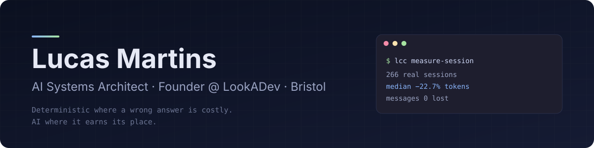

*I design and build intelligent systems that turn complex business processes into scalable operations.*

---

## Work with me

I take repetitive admin off UK practices and small teams: enquiry capture and routing, booking handoffs, document-to-ERP pipelines, CRMs and dashboards. Deterministic logic wherever a wrong answer is costly, AI only where it earns its place.

**In production:** a pipeline for Cainelli Bebidas that writes supplier invoices into their Tiny ERP against a 5,222-product catalogue. Early on it created about 60 duplicate products; I traced the root cause, fixed it with a local catalogue index and anti-duplicate locks, and published the post-mortem.

Diagnosis → 7-day sprint → care plan. Start with the [free 40-second diagnosis](https://lookadev.com/en/diagnose).

---

## ⭐ Featured open source: [lcc — Local Context Compiler](https://github.com/lucasmartins-ai/lcc)

**Compact coding-agent context without summarizing it away.** Claude Code's `/compact` rewrites
your session into a summary; lcc moves spent tool outputs to a local stash, keeps every message
byte for byte, and gives any removed output back with `recall`.

Across 40 of my long Claude Code sessions: **median 18.8% fewer tokens, best 53%, 0 messages lost**,
offline, exact token counts. CLI, MCP server and Claude Code plugin. MIT.

`pip install local-context-compiler` ·   · Try it on your sessions: `lcc measure-session <file>.jsonl --markdown`

---

## What I do

Most businesses don't have a software problem. They have a **systems problem** — leads split across four channels, data copy-pasted between WhatsApp, spreadsheets and a CRM, and no one clear on who should act.

I diagnose the real workflow, model the architecture that removes the manual handoffs, and build the system. I sit at the intersection of **AI, software engineering, business process and product thinking** — which is why I design the solution before writing code, and measure the outcome after.

AI Systems · AI Automation · Business Process Automation · Custom Software · AI Agents · Data Systems · Operational Systems · Product Engineering

---

## Method

**Diagnose → Map → Quantify → Architect → Automate → Build → Measure**

I never start with technology. I start by understanding the business, mapping the real process, quantifying the cost of the current state, and only then deciding the architecture.

---

## Selected systems

Each of these is a system I designed and built — a business problem turned into an architecture, not a feature list. Full case studies on [LookADev](https://lookadev.com/en/cases).

| System | The problem | The system |
| :--- | :--- | :--- |
| **[AgentTrace Studio](https://github.com/lucasmartins-ai/agenttrace-studio)** | AI agents are unreliable in real codebases | An evaluation & observability platform that gates AI agents through CI/CD quality checks before they ship |
| **[LookaBerry](https://github.com/lucasmartins-ai/lookaberry)** | Cold outreach burns time and gets leads ignored | An autonomous GTM system that ranks leads in-database (pgvector), enriches with 0 LLM tokens, and sequences outreach with anti-ban guardrails |
| **[AI Reception](https://github.com/lucasmartins-ai/ai-reception-lite)** | Small businesses lose leads after the first enquiry | An AI receptionist that captures, classifies and qualifies enquiries, then hands hot leads to a human |
| **[LookaCrawler](https://github.com/lucasmartins-ai/lookacrawler)** | Web pages waste thousands of tokens for AI agents | A token-optimized crawler that strips >73% of HTML noise and exposes a native MCP server |
| **[lcc](https://github.com/lucasmartins-ai/lcc)** | Prompt context is bloated and expensive | A local-first context compiler that cuts agent sessions (median −18.8% over 40 real Claude Code sessions, offline) while keeping every message byte for byte, with an audit receipt |
| **[OpsCommand](https://github.com/lucasmartins-ai/ops-command-lite)** | Operations data is scattered and unreadable | An accessible operations dashboard that turns scattered KPIs into a single command view |

---

## Currently building

- **LookABerry** — closing the feedback loop between outbound signals and intent scoring, so the system gets smarter as it runs.
- **AgentTrace Studio** — expanding the eval gate so it catches citation and regression failures automatically.

---

## Stack

## Open-source & tooling

[lcc](https://github.com/lucasmartins-ai/lcc) · [lookacrawler](https://github.com/lucasmartins-ai/lookacrawler) · [agentic-prompt-intake](https://github.com/lucasmartins-ai/agentic-prompt-intake) · [lookapentest](https://github.com/lucasmartins-ai/lookapentest) · [antigravity-gemini-extension](https://github.com/lucasmartins-ai/antigravity-gemini-extension)

---

## Connect

[LookADev](https://lookadev.com) · [LinkedIn](https://www.linkedin.com/in/lucas-martins-nw/) · [GitHub](https://github.com/lucasmartins-ai) · [Email](mailto:lucas@lookadev.com)

  <b>LUCAS MARTINS</b> — AI Systems Architect • <b>LOOKADEV</b> — AI Systems & Automation Studio

